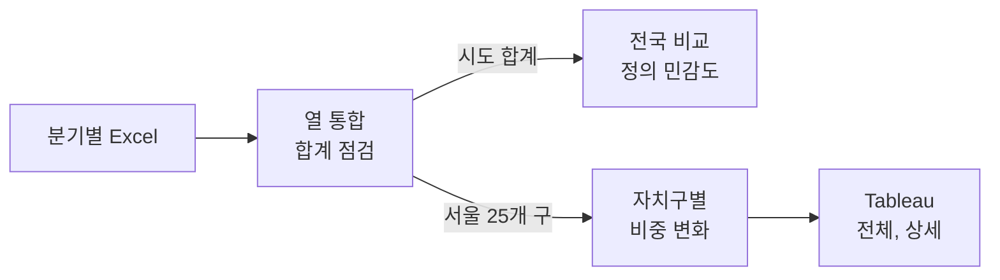
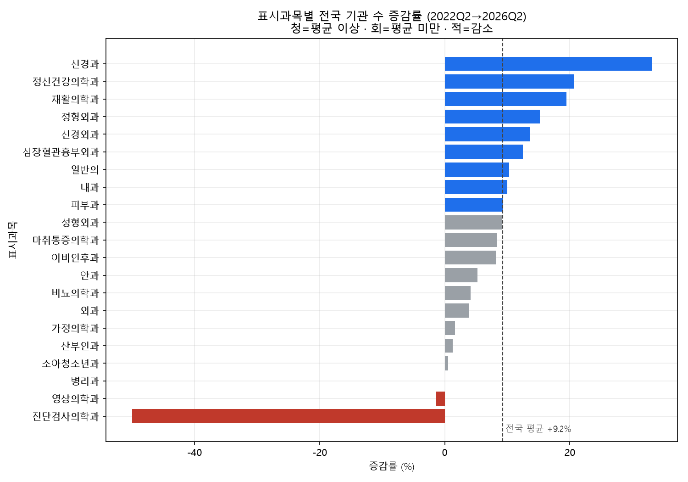
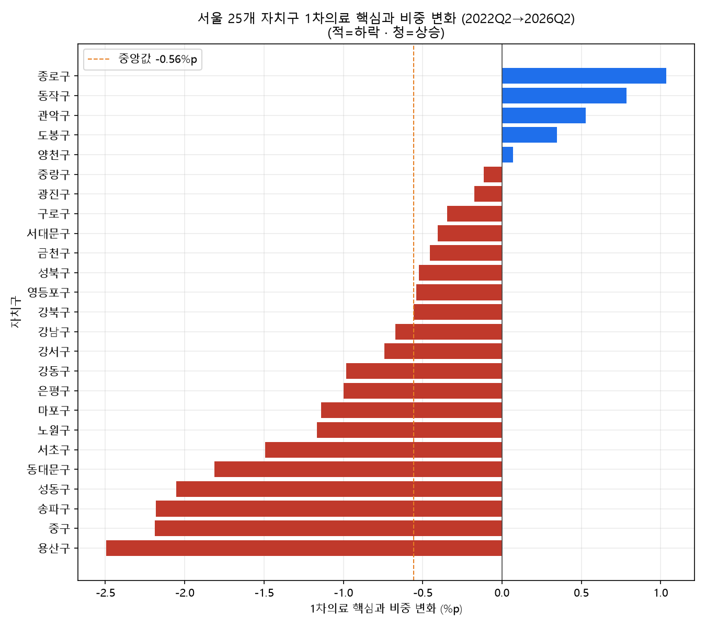
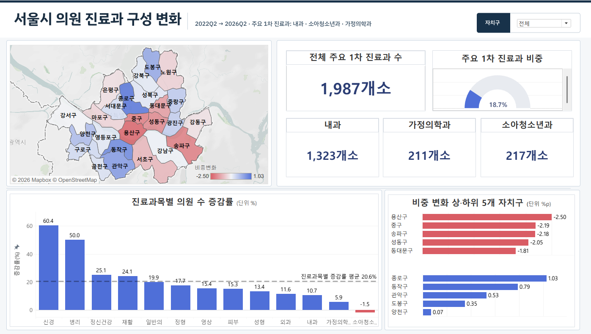

# Seoul Primary Care Trends

## Overview

서울시 의원의 주요 1차 진료과 구성이 어떻게 달라졌는지 분석.
2022Q2–2026Q2의 분기별 표시과목 통계로 전국 17개 시도와 서울 25개 자치구를 비교.
Tableau에서 서울 전체 지표를 확인하고 자치구별 변화와 보건기관 위치를 탐색할 수 있도록 구성.

   

BOAZ 27기 시각화 미니 프로젝트, 데이터 청진기 3인 팀. 팀원 김지우, 신민아, 진서현. 개인별 담당은 확인 후 기록 예정.

## Data

| Source | Scope | Role |
|---|---|---|
| 건강보험심사평가원 지역별 의원 표시과목별 기관수 | 2022Q2–2026Q2, 전국 17개 시도와 시군구, 26개 표시과목 | 주요 분석 |
| 건강보험심사평가원 종별 요양기관 수 | 전국, 동일 비교 시점 | 의원 총수 대조 |
| 행정안전부 주민등록인구 | 전국 연령별 인구, 서울 자치구 인구 | 인구 맥락과 인구 대비 지표 |
| 서울 열린데이터광장 소아의료체계, 시설물 정보 | 서울 소재 기관 | 대시보드 위치 레이어 |

[출처와 원자료 배치](data/README.md)

## Research Design

1. **분기별 기관 수 통합**

   - 17개 Excel의 표시과목 열을 합집합으로 통일하고 시도명 변경을 표준화.
   - 원본 코드 기준으로 미등장 과목, 대시와 숫자로 변환할 수 없는 값을 0으로 처리.
   - 전체 열과 과목 합계 일치, 시군구 키 중복, 서울 자치구 범위 확인.

2. **구성 변화 비교**

   - 주요 1차 진료과의 운영정의는 내과, 소아청소년과, 가정의학과.
   - 세 과목의 기관 수 합계를 전체 의원 수로 나누어 비중 산출. 2026Q2 비중에서 2022Q2 비중을 빼 변화폭 계산.
   - 전국 비교는 시도 합계 행, 서울 자치구 비교는 개별 구 행 사용. 과목 범위를 네 가지로 바꿔 서울의 감소폭 순위 비교.

3. **서울 전체와 자치구 시각화**

   - Tableau의 선택구 매개변수로 서울 전체와 자치구 상세 화면 전환.
   - 주민등록인구 1만 명당 의원 수와 소아, 보건기관 위치를 보조 정보로 배치.

## Analysis Workflow



## Key Results

### National Trends

- 2022Q2–2026Q2 전국 의원 수 **34,541 → 37,731개소**, **9.2% 증가**.
- 같은 기간 신경과 **33.1%**, 정신건강의학과 **20.7%** 증가. 소아청소년과 **0.6%**, 가정의학과 **1.6%** 증가.



2022Q2 대비 2026Q2 전국 증감률. 그림의 비교 대상은 기준 시점 10개소 이상인 과목.

### Seoul and Districts

- 서울 전체 의원 수 **9,359 → 10,634개소**, 주요 세 과목 합계 **1,854 → 1,987개소**. 전체 의원이 더 빠르게 늘어 세 과목 비중은 **19.81% → 18.69%**.
- 주 정의에서 서울은 **−1.12%p**로 17개 시도 중 감소폭 1위. 대안 정의에 따라 1–6위.
- 서울 25개 구 중 **20개 구 하락**, **5개 구 상승**. 범위는 용산구 **−2.50%p**부터 종로구 **+1.03%p**까지.



2022Q2 대비 2026Q2, 구별 전체 의원 수를 분모로 계산한 비중 변화.

### Tableau Dashboard



발표자료 14쪽의 전체 화면. 세 과목 합계와 비중, 지도, 과목별 증감률을 한 화면에 배치. 과목별 카드의 표시 차이는 아래 문서에 기록.

[공개 대시보드](https://public.tableau.com/shared/97SJWNZ7N) · [자치구 상세 화면과 계산 필드](dashboard/README.md)

## Limitations

- 표시과목은 기관 명칭 기준이며 실제 제공하는 진료기능과 차이가 있을 수 있음.
- 의원 수와 인구 대비 의원 수는 기관 분포 지표. 진료량, 의료인력, 운영시간과 환자 이동을 포함한 공급 역량은 별도 자료 필요.
- 구성비 감소와 의료 공백 발생은 별개의 질문. 지역 차이의 원인과 의료취약지역 판단에는 수요, 접근성, 진료 실적의 추가 검토 필요.
- 시군구 경계 변화와 분기별 표시과목 분류 차이로 장기 비교에 제약 존재.

## Repository Structure

```text
├── data/        # 출처와 원자료 배치
├── notebooks/   # 전처리, 품질 점검, EDA
├── src/         # 저장 결과 교차검증
├── results/     # 집계표, 그림, HTML 요약
├── dashboard/   # Tableau 화면과 계산 근거
└── docs/        # 재현 범위와 검증 기록
```

[실행 순서](notebooks/README.md) · [결과 안내](results/README.md) · [검증 기록](docs/validation.md)
