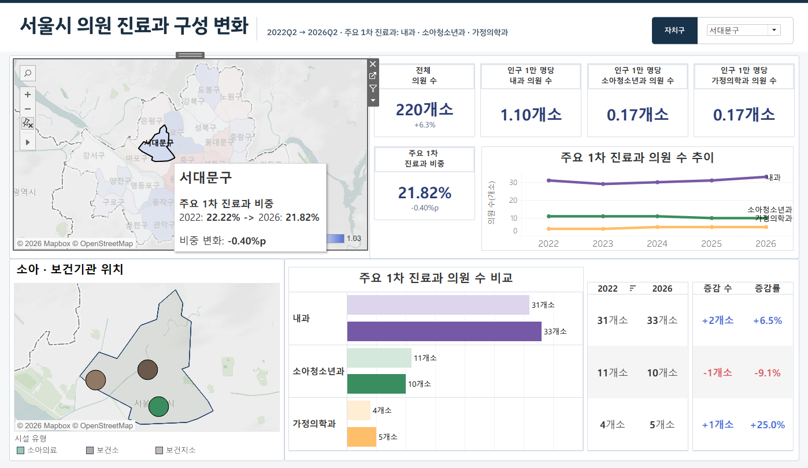

# Tableau Dashboard

[Tableau Public 시연](https://public.tableau.com/shared/97SJWNZ7N). 2026-11-04 공유 주소의 최종 페이지 HTTP 200 확인. 인터랙션은 로컬 Tableau 실행 대신 원본 워크북 XML과 발표자료로 확인.

| Item | Workbook Evidence |
|---|---|
| 구성 | 대시보드 1개, 워크시트 20개. 전체 의원 수, 주요 과목 비중, 반원 게이지, 비중 지도, 병원지도와 인구 대비 KPI |
| 선택구 | 전체와 25개 구의 매개변수. 전체보기여부, 구보기여부 계산으로 표시 전환 |
| 전체 | 서울의 기관 수, 비중, 진료과별 증감률, 비중 변화 상하위 5개 구 |
| 상세 | 구별 기관 수, 인구 1만 명당 과목별 기관 수, 연도별 추이와 위치 지도 |
| 상호작용 | XML의 하이라이트 액션과 선택구 경계 필터. 발표자료에 지도 선택과 자동 확대 시연 |
| 계산 | 2022Q2, 2026Q2 조건부 합계, 차이와 증감률, 세 과목 비중 차이(%p), 구별 인구 MAX를 사용하는 INCLUDE 계산 |

발표자료 15쪽. 서대문구 총 220개소, 세 과목 비중 21.82%. 인구 대비 카드는 표시값 차이가 있어 검증된 수치로 인용하지 않음.

- 서울 전체 발표 화면의 **1,987개소, 18.7%**는 재계산과 일치. 세부 카드 중 소아청소년과와 가정의학과는 재계산한 **447개소, 217개소**와 화면의 **217개소, 211개소**가 다름. 저장된 화면과 워크북이 같은 실행 상태인지 확인할 근거 부족. 분석 결과는 재계산값 기준.
- 서대문구 2026Q2 총인구 299,810명과 과목별 33, 10, 5개소로 계산한 1만 명당 값은 각각 **1.10, 0.33, 0.17**. 발표 화면의 소아청소년과 카드 **0.17**은 이 분모와 분자로 재현되지 않음.
- 원본 패키지는 TWB, Hyper 추출, 레이아웃 이미지 2개 포함. 연결 XML에 로컬 파일 참조와 여러 출처가 섞여 있고 추출 전체의 재배포 범위 확인이 남아 있어 패키지는 공개 제외.
